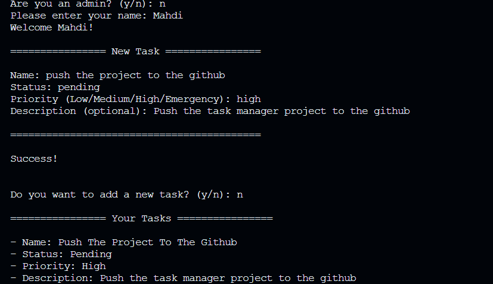
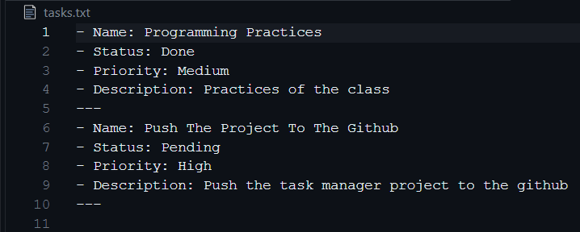
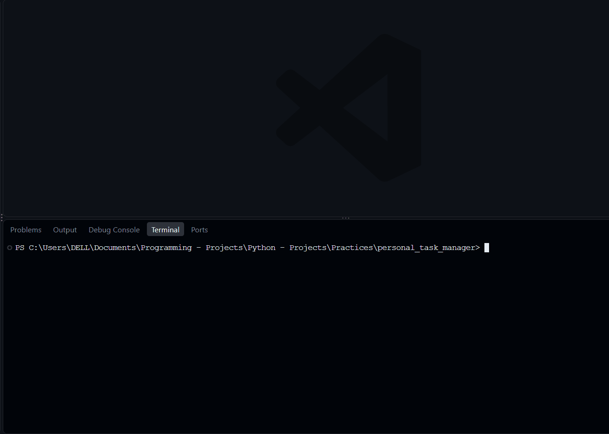

# Personal Task Manager


A command-line task manager built with Python for organizing personal tasks. It is designed as a practical Git and GitHub project, with persistent task storage, task status management, priorities, and a password-protected admin mode.


## Table of Contents

- [Personal Task Manager](#personal-task-manager)
  - [Table of Contents](#table-of-contents)
  - [Description](#description)
  - [Features](#features)
  - [Project Structure](#project-structure)
  - [File Description](#file-description)
  - [Requirements](#requirements)
  - [Installation](#installation)
  - [Environment Setup](#environment-setup)
  - [Usage](#usage)
  - [Example Output](#example-output)
  - [Screenshots](#screenshots)
    - [Application start](#application-start)
    - [Task History](#task-history)
  - [Demo](#demo)
  - [Roadmap](#roadmap)
  - [Contributing](#contributing)
  - [License](#license)
  - [Author](#author)

## Description

**Personal Task Manager** is a Python application that lets a user create and manage a personal task list from the terminal. Tasks can be displayed, marked as completed, and deleted. Task data is saved to a local file so it can be loaded again the next time the application runs.

The project also includes task priorities and a simple admin mode. The admin password is read from an environment variable in a local `.env` file instead of being hard-coded in the Python source.

This repository is also a hands-on exercise in using Git and GitHub, including meaningful commits, feature branches, pushing branches, merging changes, and maintaining project documentation.

## Features

- Ask for the user's name and display a welcome message.
- Add new tasks with a title.
- Display the task list.
- Track each task as `pending` or `done`.
- Mark a task as completed.
- Delete a task.
- Save tasks locally so they persist between program runs.
- Assign a priority to a task: `low`, `medium`, `high` or `emergency`.
- Provide a password-protected admin mode.

## Project Structure

The following is the intended final structure. The screenshots and demo GIF should be added after capturing them from a real run of the application. Local data and the `.env` file should not be committed.

```text
personal_task_manager/
├── gifs/
│   └── demo.gif
├── pictures/
│   ├── start.png
│   └── tasks-hostory.png
├── main.py
├── tasks.py
├── requirements.txt
├── .env.example
├── .gitignore
└── README.md
```

A local `.env` file and the task-data file may also exist on your computer. They are intentionally omitted from the public repository when ignored by Git.

## File Description

| File or folder | Purpose |
| --- | --- |
| `main.py` | Application entry point and main user interaction. |
| `tasks.py` | Task-related logic and operations. |
| `requirements.txt` | Lists external Python packages required by the project. |
| `.env.example` | Example environment-variable configuration; contains no real password. |
| `.gitignore` | Specifies local data, secrets, logs, and cache files that Git should ignore. |
| `pictures/` | Contains real screenshots of the application for the README. |
| `gifs/demo.gif` | Short GIF showing a real application run. |
| `README.md` | Project overview, setup instructions, usage information, and documentation. |
| Local task-data file | Stores tasks between runs. Its filename depends on the implementation and should be ignored if it contains personal or generated data. |

## Requirements

- Python 3.10 or newer is recommended.
- The external Python package `python-dotenv`.

The application uses Python's built-in modules where possible. Built-in modules such as `os` should not be added to `requirements.txt`.

## Installation

1. Clone your repository:

   ```bash
   git clone https://github.com/ejlalpourmahdi/personal_task_manager.git
   ```

2. Move into the project directory:

   ```bash
   cd personal_task_manager
   ```

3. Install the dependencies:

   ```bash
   python -m pip install -r requirements.txt
   ```

4. Configure the environment as described below.

## Environment Setup

The admin password must not be written directly into the Python source code or committed to Git.

1. Create a local `.env` file by copying `.env.example`.

   **Windows PowerShell:**

   ```powershell
   Copy-Item .env.example .env
   ```

   **macOS / Linux:**

   ```bash
   cp .env.example .env
   ```

2. Open `.env` and set a **test password used only for this project**:

   ```dotenv
   TASK_MANAGER_ADMIN_PASSWORD=your_test_password
   ```

3. Confirm that `.env` is listed in `.gitignore`, while `.env.example` remains tracked by Git.

Do not use a real password from any personal account. Do not commit or push `.env`. The example file should contain only a placeholder, for example:

```dotenv
TASK_MANAGER_ADMIN_PASSWORD=your_password_here
```

## Usage

After installing the dependencies and configuring `.env`, start the application from the project directory:

```bash
python main.py
```

Follow the prompts in the terminal to enter your name and manage tasks. Depending on the implementation, the menu should allow you to add tasks, list tasks, mark a task as done, delete a task, and assign or view priorities. When prompted, enter the admin password configured in `.env` to test admin mode.

The task-data file is created or updated by the application. If it contains personal or generated task data, keep it local and make sure Git ignores it.

## Example Output

The following is **illustrative output**, not a captured screenshot. Exact wording and menu options may differ depending on the implementation.

```text
Are you an admin? (y/n): n
Please enter your name: Mahdi
Welcome Mahdi!

================ New Task ================

Name: programming practices 
Status: done
Priority (Low/Medium/High/Emergency): medium
Description (optional): Practices of the group meetings 

==========================================

Success!


Do you want to add a new task? (y/n): n

================ Your Tasks ================

- Name: Programming Practices
- Status: Done
- Priority: Medium
- Description: Practices of the group meetings
```

## Screenshots

Some picture of application run

### Application start



### Task History



## Demo

A short GIF of a real application run



## Roadmap

- [x] Create the initial Python application structure.
- [x] Add task creation and task-list functionality.
- [x] Store tasks locally between runs.
- [x] Add task priorities (`low`, `medium`, `high`).
- [x] Add a simple admin mode using a password from `.env`.
- [] Support task completion and deletion.
- [ ] Add due dates for tasks.
- [ ] Implement task search and filtering by title, status, and priority.
- [ ] Display task statistics and completion progress.
- [ ] Add the ability to edit existing tasks.
- [ ] Implement data backup and restoration using JSON.
- [ ] Write automated tests to verify the application's functionality.
- [ ] Add task sorting by priority or due date.
- [ ] Improve error handling and user input validation.


## Contributing

* **Coming Soon...**

## License

* **Coming Soon...**

## Author

**Mohammad Mahdi**

- GitHub: [@ejlalpourmahdi](https://github.com/ejlalpourmahdi)
